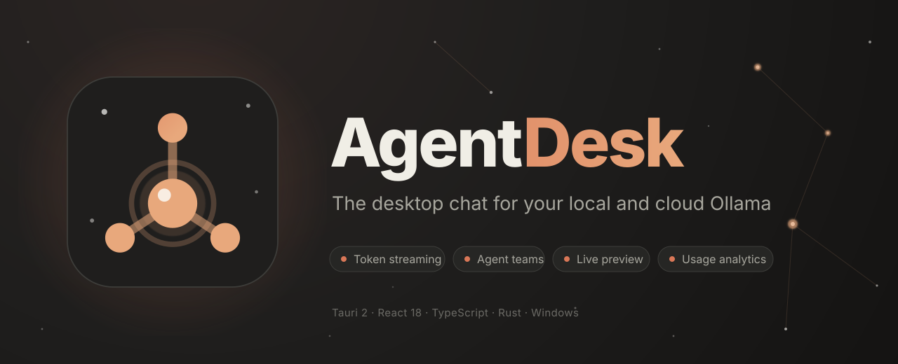
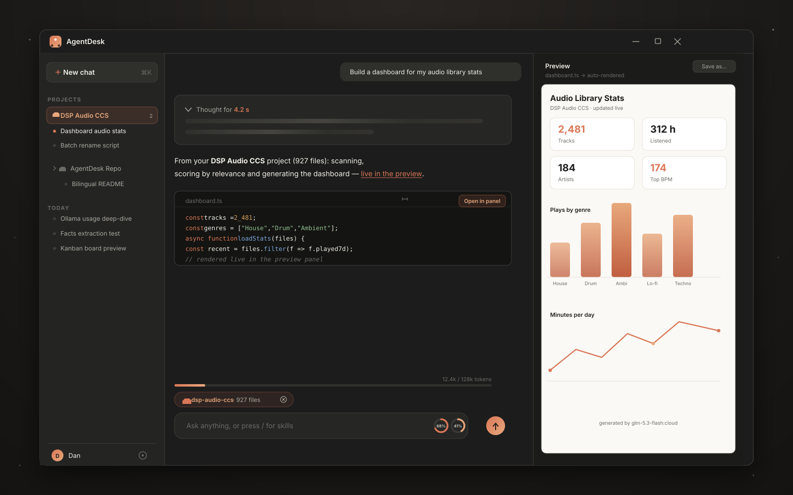
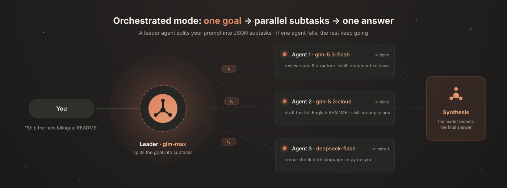

# AgentDesk

[English](README.md) | Español

<div align="center">
  
</div>

     

**App de escritorio estilo Claude Desktop que funciona como wrapper de chat contra tu Ollama local o de nube**, con panel de pensamiento del modelo en tiempo real, menú `/` que carga tus skills de `~/.claude/skills`, equipos de agentes en paralelo, medidor de contexto y de uso con tokens reales, proyectos con carpeta de contexto, memoria integrada, adjuntos, panel de vista previa y creador de interfaces.

> Versión actual: **0.2.2** (rama `feature/agentdesk`) · Fecha de estado: 2026-11-23

---

## Índice

- [Características](#características)
- [Cómo funciona](#cómo-funciona)
- [Requisitos previos](#requisitos-previos)
- [Puesta en marcha](#puesta-en-marcha)
- [Uso de la aplicación](#uso-de-la-aplicación)
- [Arquitectura](#arquitectura)
- [Persistencia y datos](#persistencia-y-datos)
- [Seguridad](#seguridad)
- [Tests](#tests)
- [Estructura del repositorio](#estructura-del-repositorio)
- [Estado y hoja de ruta](#estado-y-hoja-de-ruta)
- [Documentación relacionada](#documentación-relacionada)

---

## Características

<div align="center">
  
</div>

### Chat

- **Streaming token a token** contra Ollama (default `http://localhost:11434`, URL configurable en settings), con parser NDJSON hecho en Rust y chunks tipados hacia TypeScript.
- **Panel de pensamiento** (`ThinkingPanel`): colapsable, con shimmer mientras el modelo razona y duración en segundos. Solo aparece en modelos con la capability `thinking`.
- **Markdown completo**: react-markdown + GFM + syntax highlighting en bloques de código con botón de copiar.
- **Meter de contexto**: barra con tokens usados / límite real del modelo (ámbar ≥80 %, rojo ≥95 %).
- **Reintentar** en mensajes fallidos y en el banner cuando Ollama está caído.
- Tema claro/oscuro con contraste WCAG AA validado por test, focus rings y reduced-motion.

### Skills y menú `/`

- El menú `/` carga **tus skills reales de `~/.claude/skills`** (frontmatter YAML-subset parseado en Rust, con validación anti-path-traversal) y las fusiona con los comandos integrados:
  `/model` · `/agents` · `/new` · `/clear` · `/theme` · `/memoria` · `/interfaz`.
- Filtro en vivo, navegación por teclado (↑ ↓ Enter Esc) y ARIA listbox.

### Agentes en paralelo

- **Modo manual**: escribes un prompt y todos los agentes del equipo responden en paralelo con aislamiento de fallos (`Promise.allSettled`): si uno cae, el resto sigue.
- **Modo orquestado**: un líder (por defecto `glm-max`) divide tu meta en **subtareas JSON** (con reintentos y matching tolerante), las despacha a los agentes en paralelo y redacta una **síntesis final**.
- Editor de equipos: nombre de agente, modelo, skill y rol; persistencia automática.

<div align="center">
  
</div>

### Proyectos (v2.6)

- Sidebar con **proyectos y chats**: crear, renombrar y borrar; tocar un proyecto abre su pantalla con los últimos chats como chips bajo el input.
- **Carpeta vinculada por proyecto**: al activarla, todos los chats del proyecto usan la carpeta como contexto automático — el sistema busca en ella según la consulta (score por contenido y nombre) y solo inyecta los archivos relevantes (presupuesto 30k tokens, índice siempre incluido, caché 60 s).
- **Títulos por tema**: cada chat se nombra automáticamente con una llamada oculta al modelo.
- **Memoria guardada**: tras cada intercambio se extraen ≤3 hechos relevantes a `facts.json`, y el modelo los recuerda en la conversación ("mira qué era esto").
- Panel de proyecto en modo **Estado**: memoria + hechos + tokens.

### Adjuntos y contexto

- **Archivos…** inyecta el texto del archivo al mensaje.
- **Carpeta…** queda como **chip de contexto** sobre el input (ruta + nº de archivos); al enviar se hace búsqueda por relevancia y Rust filtra `.git`, `node_modules` y dotfiles (máx. 300 archivos).

### Panel de vista previa y `/interfaz`

- Columna derecha que renderiza **HTML en iframe sandbox**, markdown, CSV como tabla e imágenes. Los mensajes con bloques `html` / `md` / `csv` ganan un botón «Abrir en panel», y el panel permite «Guardar como…».
- **`/interfaz`**: el modelo genera un HTML completo y el panel lo muestra vivo con auto-open al terminar.

### Medidor de uso (v2.1 + v2.2)

- Dos anillos en la barra del chat (sesión y semana móvil; ámbar ≥80 %, rojo ≥95 %) con clic al dashboard.
- Pestaña **Uso**: presupuesto restante, modelos más usados (con turno y barras) y distribución por día.
- Tokens reales de Ollama (`prompt_eval_count` + `eval_count`) registrados en `usage.json` con cada `done` de chat y de agente. Presupuestos default **500k sesión / 2M semana** (editables con `sessionBudget` / `weekBudget`).
- **Uso real de Ollama Cloud**: con tu API key (ollama.com › Keys) trae tokens de entrada/caché/salida, gasto en USD, barras por rango (24 h / 7 d / 30 d) y request-count por modelo.

### Memoria integrada (v2.4)

- Tu carpeta de fichas de memoria (default `claude-memory-2026-11-22`) se escanea y se **inyecta como system prompt permanente** en todos los chats — el modelo conoce tus proyectos sin adjuntar nada.
- Chip de estado junto al input (nº de fichas), comando `/memoria` para activarla/desactivarla y presupuesto de 80k caracteres con recorte avisado.

---

## Cómo funciona

```
┌────────────────────────────────────────────────────────────┐
│  Frontend (React 18 + TS + Tailwind v4 + zustand)          │
│  ChatView · AgentsView · UsageView · PreviewPanel · Sidebar│
└───────────────▲────────────────────────────────────────────┘
                │  invoke() + Channel (chunks tipados)
┌───────────────┴────────────────────────────────────────────┐
│  Tauri 2 — Rust delgado                                    │
│  chat.rs (streaming NDJSON) · ollama.rs · skills.rs        │
│  files.rs · tools.rs · cloud_usage.rs · credentials.rs     │
│  store_fs.rs (persistencia JSON en appDataDir)             │
└───────────────▲────────────────────────────────────────────┘
                │  HTTP
┌───────────────┴───────────────┐    ┌──────────────────────┐
│  Ollama local / Ollama Cloud  │    │  ~/.claude/skills/   │
│  localhost:11434 (default)    │    │  carpeta de memoria  │
└───────────────────────────────┘    └──────────────────────┘
```

- **NDJSON se parsea en Rust** (con test de línea partida); TypeScript recibe chunks ya tipados por `Channel` con batching de 16 ms.
- **Tokens reales** en vez de estimaciones: el `done` de Ollama trae `prompt_eval_count` + `eval_count`.
- Rust es deliberadamente delgado: ventana, proxy de streaming, filesystem y validación; toda la lógica de UI/estado vive en el frontend.

---

## Requisitos previos

| Requisito | Detalle |
|-----------|---------|
| **Node.js** | 18+ con npm |
| **Rust** | Toolchain **stable** (Tauri 2.12+ usa edition 2024; con 1.80 no compila — usa `rustup update`) |
| **Ollama** | Corriendo en `http://localhost:11434` (o la URL que configures) — `ollama serve` / la app de escritorio |
| **Ollama Cloud** *(opcional)* | API key de ollama.com para modelos `:cloud` y la sección de uso real |
| **Windows** | 10/11 x64 (el bundle NSIS/MSI es de Windows) |

## Puesta en marcha

```bash
# 1. Clonar e instalar dependencias
git clone https://github.com/<tu-usuario>/agentdesk.git
cd agentdesk
npm install

# 2. Modo desarrollo (requiere Ollama arriba)
npm run tauri dev

# 3. Compilar release
npm run tauri build
```

Artefactos del build release:

- **Binario:** `src-tauri\target\release\agentdesk.exe`
- **Instaladores:** `src-tauri\target\release\bundle\` → `AgentDesk_x64-setup.exe` (NSIS) y `.msi`

Otros scripts de `package.json`:

```bash
npm run dev        # solo frontend Vite (sin ventana Tauri)
npm run build      # typecheck tsc + vite build
npm run test       # Vitest (tests TS)
cargo test         # dentro de src-tauri/ → tests Rust
```

> Si `cargo` falla con errores de edition2024, actualiza la toolchain: `rustup update stable` (este repo usa override local a stable sin tocar tu default global).

---

## Uso de la aplicación

### Modelos

El selector de modelo muestra primero los **alias**, luego todos los modelos de `ollama list`:

| Alias | Modelo |
|-------|--------|
| `glm` | glm-5.3-flash:cloud |
| `glm-max` | glm-5.3:cloud |
| `deepseek` | deepseek-v4.1-flash:cloud |

Los alias se configuran en settings.

### Comandos integrados (menú `/`)

| Comando | Qué hace |
|---------|----------|
| `/model` | Abre el selector de modelos (con alias) |
| `/agents` | Cambia a la vista de agentes/equipos |
| `/new` | Chat nuevo |
| `/clear` | Limpia el chat actual |
| `/theme` | Alterna claro/oscuro |
| `/memoria` | Activa/desactiva la memoria integrada |
| `/interfaz` | Pide al modelo un HTML completo y lo abre en el panel de vista previa |

Además, todo lo que haya en `~/.claude/skills` aparece como skill seleccionable en el mismo menú.

### Flujo típico

1. **Arranca Ollama** y abre AgentDesk.
2. Elige modelo (`/model`) — los alias están arriba.
3. Escribe en el input; si presionas `/` se abre el menú de skills y comandos.
4. ¿Respuesta larga de un modelo thinking? Abre el **panel de pensamiento** para ver el razonamiento en vivo.
5. **Adjunta** archivos o vincula una **carpeta** como chip de contexto.
6. El resultado en HTML/Markdown/CSV lo abres en el **panel de vista previa** con «Abrir en panel».
7. Organiza el trabajo en **proyectos** desde la sidebar; el título y la memoria se llevan solos.
8. Vigila tus presupuestos con los **anillos de uso** de la barra y revisa el detalle en la pestaña Uso.

---

## Arquitectura

### Frontend (`src/`)

| Capa | Archivos | Responsabilidad |
|------|----------|-----------------|
| **Vistas** | `App.tsx`, `components/ChatView`, `AgentsView`, `UsageView`, `Sidebar`, `PreviewPanel` | Pantallas de la app |
| **Componentes de chat** | `ChatInput`, `MessageBubble`, `ThinkingPanel`, `CodeBlock`, `SlashMenu`, `ModelPicker`, `ErrorBanner`, `ContextMeter`, `UsageRing` | UI del chat y métricas |
| **Store (zustand)** | `store/chat`, `agents` (broadcast + orquestador), `projects`, `memory`, `facts`, `usage`, `preview` | Estado de la app, streaming, aislamiento de fallos |
| **Librería pura (testeable)** | `lib/ollama`, `models` (alias), `skills`, `slashMenu`, `orchestrator`, `folderContext` (búsqueda por relevancia), `usage`, `cloudUsage`, `persist`, `theme`, `contrast`, `markdown`, `preview`, `facts`, `tools` | Lógica sin React, 100 % con tests unitarios |

### Backend Rust (`src-tauri/src/`)

| Módulo | Comandos Tauri | Qué hace |
|--------|----------------|----------|
| `ollama.rs` | `list_models` | `GET /api/tags` — el TS aplica aliases y ordena |
| `chat.rs` | `chat_start`, `chat_stop` | Proxy de streaming: parsea NDJSON, emite chunks por `Channel`, soporta cancelación |
| `skills.rs` | `list_skills`, `read_skill` | Lee `~/.claude/skills` con validación anti-path-traversal |
| `files.rs` | `read_file`, `write_file`, `read_dir_files` | Adjuntos y listado recursivo de carpetas (filtra `.git`/`node_modules`/dotfiles) |
| `tools.rs` | `search_files`, `run_command` | Búsqueda de archivos y ejecución de comandos (fase agéntica) |
| `cloud_usage.rs` | `cloud_usage` | `Ollama Cloud /api/usage` con API key: tokens, USD, buckets |
| `credentials.rs` | `get/set_ollama_api_key` | API key en el **Administrador de credenciales de Windows (DPAPI)** — nunca en archivos |
| `store_fs.rs` | `*_save` / `*_load` ×7 + `agentmemory_probe` | Persistencia JSON tolerante en `appDataDir` |

---

## Persistencia y datos

Todo vive en `appDataDir` (`%APPDATA%\com.danpc.agentdesk\` en Windows), guardado con debounce de 800 ms y lectura tolerante a JSON corrupto:

| Archivo | Contenido |
|---------|-----------|
| `history.json` | Chats, mensajes, tokens por mensaje |
| `settings.json` | Tema, URL de Ollama, alias de modelos, presets |
| `projects.json` | Proyectos, carpeta vinculada, chats por proyecto |
| `teams.json` | Equipos de agentes |
| `usage.json` | Tokens acumulados, presupuestos (`sessionBudget`, `weekBudget`) |
| `memory.json` | Estado de la memoria integrada |
| `facts.json` | Hechos extraídos por proyecto (memoria guardada) |
| `credentials.json` *(no existe)* | ❌ La API key de Ollama **nunca** se guarda en archivos: vive en DPAPI/Windows Credential Manager (con migración automática de `usage.json` viejos) |

---

## Seguridad

- **API key en DPAPI**: el comando expone solo get/set contra Windows Credential Manager.
- **Anti-path-traversal**: `skills.rs` valida rutas antes de leer; `files.rs` filtra dotfiles, `.git` y `node_modules`, con límite de 300 archivos.
- **Preview sandbox**: el HTML del modelo se renderiza en un `iframe` con sandbox, no en el DOM de la app.
- **Contraste WCAG AA** garantizado por un test que valida la paleta (por ejemplo, `--primary-fg` pasó de blanco a `#1F1E1D` en light porque coral + blanco = 3.12:1 < 4.5).

---

## Tests

```bash
npm run test        # 160 tests TS (Vitest)
cd src-tauri && cargo test   # 25 tests Rust
npm run build       # typecheck tsc --strict limpio
```

- Los stores y librerías tienen tests unitarios puros (con mocks de IPC en `src/test/mock-ipc.ts`).
- `contrast.test.ts` valida la paleta contra ratios AA.
- Rust incluye tests para el parser NDJSON (línea partida), skills (anti-traversal) y store FS.

## Estructura del repositorio

```
agentdesk/
├── README.md · README.es.md · PROGRESO.md  # este README (EN), el README en español y el progreso del proyecto
├── docs/superpowers/                  # spec de diseño y planes de implementación
├── docs/img/                          # arte del README (hero, mock de la app, diagramas, logo)
├── src/
│   ├── App.tsx · main.tsx · index.css # shell + tokens de diseño (Tailwind v4)
│   ├── components/                    # vistas y componentes de UI (14 archivos)
│   ├── lib/                           # lógica pura testeable (ollama, models, skills, …)
│   ├── store/                         # zustand: chat, agents, projects, memory, usage…
│   └── test/mock-ipc.ts               # mocks de invoke/Channel para Vitest
├── src-tauri/
│   ├── src/                           # Rust: chat, ollama, skills, files, tools, credenc., store_fs
│   ├── capabilities/default.json      # permisos Tauri
│   ├── tauri.conf.json                # config de ventana y bundle
│   └── icons/ (+ icon-source.svg)     # logo «constelación»
└── …
```

## Estado y hoja de ruta

**Completado (v2.6, 27 tareas):** todo lo descrito en [Características](#características), con 160/160 tests TS y 25/25 Rust verdes.

**Pendiente:**

- [ ] E2E manual con modelos reales (broadcast a 2 agentes, `/interfaz` end-to-end, adjuntar `.md`, abrir HTML en panel)
- [ ] QA de fecha 2026-11-22: reporte en `.gstack/qa-reports/`
- [ ] Merge de `feature/agentdesk` a `main`
- [ ] Opcional después: tool-use real de los agentes (escribir archivos desde los equipos), truncado automático de contexto, historial de `/interfaz` por proyecto

## Documentación relacionada

- **Spec de diseño:** `docs/superpowers/specs/2026-11-22-agentdesk-design.md`
- **Plan de implementación (TDD):** `docs/superpowers/plans/2026-11-22-agentdesk.md` (+ `-v2.md`)
- **Progreso y decisiones (rulings):** `PROGRESO.md`

---

*El logo es una constelación: nodo orquestador + 3 agentes. Fuente SVG en `src-tauri/icons/icon-source.svg`, componente React en `src/assets/AgentLogo.tsx`.*
