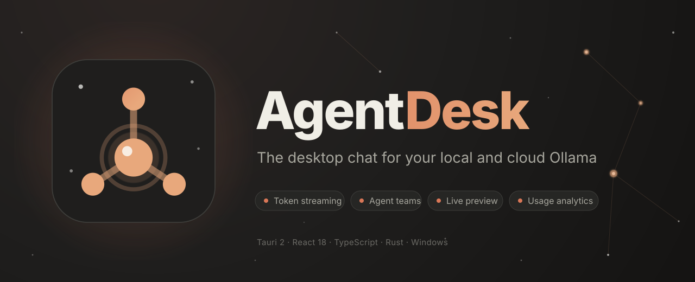
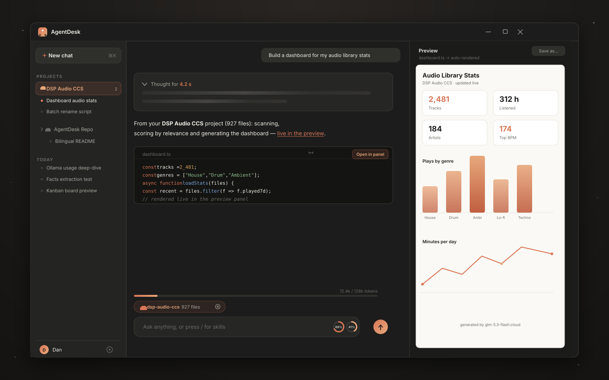
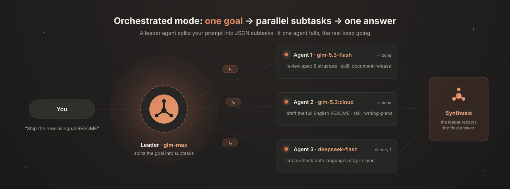

# AgentDesk

English | [Español](README.es.md)

<div align="center">
  
</div>

     

**A Claude Desktop–style desktop app that works as a chat wrapper against your local or cloud Ollama**, with a real-time model thinking panel, a `/` menu that loads your skills from `~/.claude/skills`, parallel agent teams, a token-accurate context and usage meter, projects with folder context, built-in memory, file attachments, a preview panel and an interface builder.

> Current version: **0.2.2** (branch `feature/agentdesk`) · Status date: 2026-11-23

---

## Table of Contents

- [Features](#features)
- [How It Works](#how-it-works)
- [Prerequisites](#prerequisites)
- [Getting Started](#getting-started)
- [Using the App](#using-the-app)
- [Architecture](#architecture)
- [Persistence and Data](#persistence-and-data)
- [Security](#security)
- [Tests](#tests)
- [Repository Structure](#repository-structure)
- [Status and Roadmap](#status-and-roadmap)
- [Related Documentation](#related-documentation)

---

## Features

<div align="center">
  
</div>

### Chat

- **Token-by-token streaming** against Ollama (default `http://localhost:11434`, URL configurable in settings), with the NDJSON parser living in Rust and typed chunks delivered to TypeScript.
- **Thinking panel** (`ThinkingPanel`): collapsible, with a shimmer while the model reasons and a duration readout in seconds. Only appears for models with the `thinking` capability.
- **Full markdown**: react-markdown + GFM + syntax highlighting in code blocks with a copy button.
- **Context meter**: a bar showing tokens used / the model's real limit (amber ≥80%, red ≥95%).
- **Retry** on failed messages and on the banner shown when Ollama is down.
- Light/dark theme with WCAG AA contrast validated by a test, focus rings and reduced-motion support.

### Skills and the `/` menu

- The `/` menu loads **your real skills from `~/.claude/skills`** (YAML-subset frontmatter parsed in Rust, with anti-path-traversal validation) and merges them with the built-in commands:
  `/model` · `/agents` · `/new` · `/clear` · `/theme` · `/memoria` · `/interfaz`.
- Live filtering, keyboard navigation (↑ ↓ Enter Esc) and an ARIA listbox.

### Agents in parallel

- **Manual mode**: you write a prompt and every agent on the team answers in parallel with failure isolation (`Promise.allSettled`): if one goes down, the rest keep going.
- **Orchestrated mode**: a leader (by default `glm-max`) splits your goal into **JSON subtasks** (with retries and tolerant matching), dispatches them to the agents in parallel and writes a **final synthesis**.
- Team editor: agent name, model, skill and role; persisted automatically.

<div align="center">
  
</div>

### Projects (v2.6)

- Sidebar with **projects and chats**: create, rename and delete; tapping a project opens its screen with its latest chats as chips under the input.
- **Per-project linked folder**: once linked, every chat in the project automatically uses the folder as context — the system searches it according to your query (score by content and name) and only injects the relevant files (30k-token budget, index always included, 60-second cache).
- **Topic-based titles**: every chat is named automatically with a hidden model call.
- **Saved memory**: after every exchange, up to 3 relevant facts are extracted to `facts.json`, and the model remembers them in the conversation ("look at what this was").
- Project panel with a **Status** mode: memory + facts + tokens.

### Attachments and context

- **Files…** injects the file's text into the message.
- **Folder…** stays as a **context chip** above the input (path + file count); on send, a relevance search runs and Rust filters out `.git`, `node_modules` and dotfiles (300-file cap).

### Preview panel and `/interfaz`

- A right-hand column that renders **HTML in a sandboxed iframe**, markdown, CSV as a table and images. Messages containing `html` / `md` / `csv` blocks get an "Open in panel" button, and the panel offers "Save as…".
- **`/interfaz`**: the model generates a complete HTML page and the panel shows it live with auto-open when generation finishes.

### Usage meter (v2.1 + v2.2)

- Two rings in the chat bar (session and rolling week; amber ≥80%, red ≥95%) that open the dashboard on click.
- **Usage** tab: remaining budget, most-used models (with turn and bars) and day-by-day distribution.
- Real Ollama tokens (`prompt_eval_count` + `eval_count`) recorded in `usage.json` on every chat and agent `done`. Default budgets: **500k session / 2M week** (editable via `sessionBudget` / `weekBudget`).
- **Real Ollama Cloud usage**: with your API key (from ollama.com › Keys) it fetches input/cache/output tokens, spend in USD, bars per range (24h / 7d / 30d) and request count per model.

### Built-in memory (v2.4)

- Your memory-facts folder (default `claude-memory-2026-11-22`) is scanned and **injected as a permanent system prompt** into every chat — the model knows your projects without you attaching anything.
- Status chip next to the input (number of facts), a `/memoria` command to toggle it, and an 80k-character budget with trimming warnings.

---

## How It Works

```
┌────────────────────────────────────────────────────────────┐
│  Frontend (React 18 + TS + Tailwind v4 + zustand)          │
│  ChatView · AgentsView · UsageView · PreviewPanel · Sidebar│
└───────────────▲────────────────────────────────────────────┘
                │  invoke() + Channel (typed chunks)
┌───────────────┴────────────────────────────────────────────┐
│  Tauri 2 — thin Rust layer                                 │
│  chat.rs (NDJSON streaming) · ollama.rs · skills.rs        │
│  files.rs · tools.rs · cloud_usage.rs · credentials.rs     │
│  store_fs.rs (JSON persistence in appDataDir)              │
└───────────────▲────────────────────────────────────────────┘
                │  HTTP
┌───────────────┴───────────────┐    ┌──────────────────────┐
│  Local Ollama / Ollama Cloud  │    │  ~/.claude/skills/   │
│  localhost:11434 (default)    │    │  memory folder       │
└───────────────────────────────┘    └──────────────────────┘
```

- **NDJSON is parsed in Rust** (with a test for split lines); TypeScript receives already-typed chunks over `Channel` with 16 ms batching.
- **Real tokens** instead of estimates: Ollama's `done` event carries `prompt_eval_count` + `eval_count`.
- Rust is deliberately thin: window, streaming proxy, filesystem and validation; all UI/state logic lives in the frontend.

---

## Prerequisites

| Requirement | Details |
|-------------|---------|
| **Node.js** | 18+ with npm |
| **Rust** | **Stable** toolchain (Tauri 2.12+ uses edition 2024; it won't compile on 1.80 — run `rustup update`) |
| **Ollama** | Running at `http://localhost:11434` (or whatever URL you configure) — `ollama serve` / the desktop app |
| **Ollama Cloud** *(optional)* | API key from ollama.com for `:cloud` models and the real-usage section |
| **Windows** | 10/11 x64 (the NSIS/MSI bundle is Windows) |

## Getting Started

```bash
# 1. Clone and install dependencies
git clone https://github.com/<your-user>/agentdesk.git
cd agentdesk
npm install

# 2. Development mode (requires Ollama running)
npm run tauri dev

# 3. Build release
npm run tauri build
```

Release build artifacts:

- **Binary:** `src-tauri\target\release\agentdesk.exe`
- **Installers:** `src-tauri\target\release\bundle\` → `AgentDesk_x64-setup.exe` (NSIS) and `.msi`

Other scripts from `package.json`:

```bash
npm run dev        # frontend-only Vite (no Tauri window)
npm run build      # tsc typecheck + vite build
npm run test       # Vitest (TS tests)
cargo test         # inside src-tauri/ → Rust tests
```

> If `cargo` fails with edition2024 errors, upgrade the toolchain: `rustup update stable` (this repo uses a repo-local override to stable without touching your global default).

---

## Using the App

### Models

The model picker shows **aliases** first, then every model from `ollama list`:

| Alias | Model |
|-------|-------|
| `glm` | glm-5.3-flash:cloud |
| `glm-max` | glm-5.3:cloud |
| `deepseek` | deepseek-v4.1-flash:cloud |

Aliases are configurable in settings.

### Built-in commands (`/` menu)

| Command | What it does |
|---------|--------------|
| `/model` | Opens the model picker (with aliases) |
| `/agents` | Switches to the agents/teams view |
| `/new` | New chat |
| `/clear` | Clears the current chat |
| `/theme` | Toggles light/dark |
| `/memoria` | Toggles built-in memory |
| `/interfaz` | Asks the model for a complete HTML page and opens it in the preview panel |

In addition, everything in `~/.claude/skills` shows up as a selectable skill in the same menu.

### Typical flow

1. **Start Ollama** and open AgentDesk.
2. Pick a model (`/model`) — the aliases are in the table above.
3. Type in the input; pressing `/` opens the skills-and-commands menu.
4. Long answer from a thinking model? Open the **thinking panel** to watch the reasoning live.
5. **Attach** files or link a **folder** as a context chip.
6. Open HTML/Markdown/CSV results in the **preview panel** with "Open in panel".
7. Organize your work into **projects** from the sidebar; titles and memory handle themselves.
8. Watch your budgets with the **usage rings** in the bar and check the details in the Usage tab.

---

## Architecture

### Frontend (`src/`)

| Layer | Files | Responsibility |
|-------|-------|----------------|
| **Views** | `App.tsx`, `components/ChatView`, `AgentsView`, `UsageView`, `Sidebar`, `PreviewPanel` | App screens |
| **Chat components** | `ChatInput`, `MessageBubble`, `ThinkingPanel`, `CodeBlock`, `SlashMenu`, `ModelPicker`, `ErrorBanner`, `ContextMeter`, `UsageRing` | Chat UI and metrics |
| **Store (zustand)** | `store/chat`, `agents` (broadcast + orchestrator), `projects`, `memory`, `facts`, `usage`, `preview` | App state, streaming, failure isolation |
| **Pure library (testable)** | `lib/ollama`, `models` (aliases), `skills`, `slashMenu`, `orchestrator`, `folderContext` (relevance search), `usage`, `cloudUsage`, `persist`, `theme`, `contrast`, `markdown`, `preview`, `facts`, `tools` | React-free logic, fully unit-tested |

### Rust backend (`src-tauri/src/`)

| Module | Tauri commands | What it does |
|--------|----------------|--------------|
| `ollama.rs` | `list_models` | `GET /api/tags` — TS applies aliases and sorts |
| `chat.rs` | `chat_start`, `chat_stop` | Streaming proxy: parses NDJSON, emits chunks over `Channel`, supports cancellation |
| `skills.rs` | `list_skills`, `read_skill` | Reads `~/.claude/skills` with anti-path-traversal validation |
| `files.rs` | `read_file`, `write_file`, `read_dir_files` | Attachments and recursive folder listing (filters `.git`/`node_modules`/dotfiles) |
| `tools.rs` | `search_files`, `run_command` | File search and command execution (agentic phase) |
| `cloud_usage.rs` | `cloud_usage` | `Ollama Cloud /api/usage` with the API key: tokens, USD, buckets |
| `credentials.rs` | `get/set_ollama_api_key` | API key in the **Windows Credential Manager (DPAPI)** — never in files |
| `store_fs.rs` | `*_save` / `*_load` ×7 + `agentmemory_probe` | Tolerant JSON persistence in `appDataDir` |

---

## Persistence and Data

Everything lives in `appDataDir` (`%APPDATA%\com.danpc.agentdesk\` on Windows), saved with an 800 ms debounce and tolerant reads of corrupted JSON:

| File | Contents |
|------|----------|
| `history.json` | Chats, messages, per-message tokens |
| `settings.json` | Theme, Ollama URL, model aliases, presets |
| `projects.json` | Projects, linked folder, chats per project |
| `teams.json` | Agent teams |
| `usage.json` | Accumulated tokens, budgets (`sessionBudget`, `weekBudget`) |
| `memory.json` | Built-in memory state |
| `facts.json` | Facts extracted per project (saved memory) |
| `credentials.json` *(doesn't exist)* | ❌ The Ollama API key is **never** stored in files: it lives in DPAPI / Windows Credential Manager (with automatic migration from old `usage.json`) |

---

## Security

- **API key in DPAPI**: the exposed commands do only get/set against Windows Credential Manager.
- **Anti-path-traversal**: `skills.rs` validates paths before reading; `files.rs` filters dotfiles, `.git` and `node_modules`, capped at 300 files.
- **Sandboxed preview**: HTML from the model renders inside a sandboxed `iframe`, not in the app's DOM.
- **WCAG AA contrast** guaranteed by a test that validates the palette (for example, `--primary-fg` went from white to `#1F1E1D` in light mode because coral + white = 3.12:1 < 4.5).

---

## Tests

```bash
npm run test        # 160 TS tests (Vitest)
cd src-tauri && cargo test   # 25 Rust tests
npm run build       # clean tsc --strict typecheck
```

- Stores and libraries have pure unit tests (with IPC mocks in `src/test/mock-ipc.ts`).
- `contrast.test.ts` validates the palette against AA ratios.
- Rust includes tests for the NDJSON parser (split lines), skills (anti-traversal) and the store FS.

## Repository Structure

```
agentdesk/
├── README.md · README.es.md · PROGRESO.md # this README (EN), Spanish README, project progress log
├── docs/superpowers/                  # design spec and implementation plans
├── docs/img/                          # README artwork (hero, app mock, diagrams, logo)
├── src/
│   ├── App.tsx · main.tsx · index.css # shell + design tokens (Tailwind v4)
│   ├── components/                    # views and UI components (14 files)
│   ├── lib/                           # pure testable logic (ollama, models, skills, …)
│   ├── store/                         # zustand: chat, agents, projects, memory, usage…
│   └── test/mock-ipc.ts               # invoke/Channel mocks for Vitest
├── src-tauri/
│   ├── src/                           # Rust: chat, ollama, skills, files, tools, credentials, store_fs
│   ├── capabilities/default.json      # Tauri permissions
│   ├── tauri.conf.json                # window and bundle config
│   └── icons/ (+ icon-source.svg)     # "constellation" logo
└── …
```

## Status and Roadmap

**Completed (v2.6, 27 tasks):** everything described in [Features](#features), with 160/160 TS tests and 25/25 Rust tests green.

**Pending:**

- [ ] Manual E2E with real models (broadcast to 2 agents, `/interfaz` end-to-end, attach an `.md`, open HTML in the panel)
- [ ] QA dated 2026-11-22: report in `.gstack/qa-reports/`
- [ ] Merge `feature/agentdesk` into `main`
- [ ] Optional later: real agent tool-use (writing files from teams), automatic context truncation, `/interfaz` history per project

## Related Documentation

- **Design spec:** `docs/superpowers/specs/2026-11-22-agentdesk-design.md`
- **Implementation plan (TDD):** `docs/superpowers/plans/2026-11-22-agentdesk.md` (+ `-v2.md`)
- **Progress and decisions (rulings):** `PROGRESO.md`

---

*The logo is a constellation: an orchestrator node + 3 agents. SVG source in `src-tauri/icons/icon-source.svg`, React component in `src/assets/AgentLogo.tsx`.*
